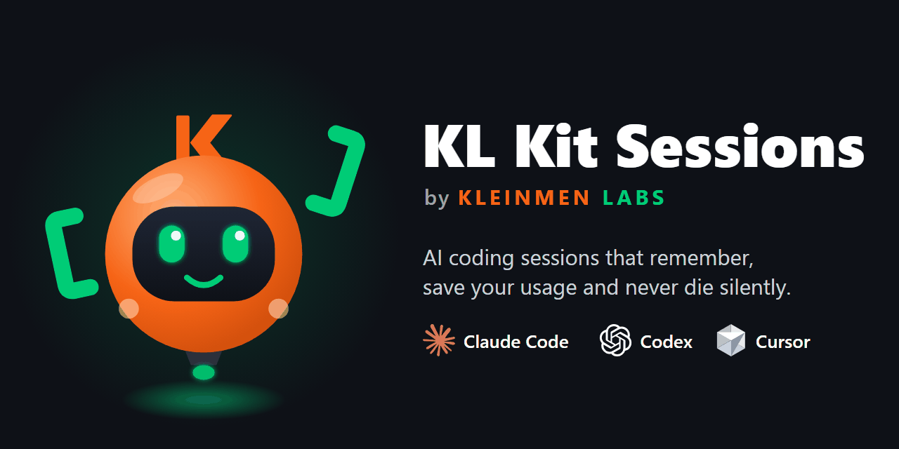

# KL Kit Sessions

*[Read in English](README.md)*

Las sesiones de los asistentes de programación con IA olvidan, se comen el cupo y se cortan sin aviso. Este kit lo arregla con tres archivos de texto y cuatro frenos pequeños. No necesita servidores ni modelos extra, solo Python.

**Sirve con:** Claude Code, Codex, Cursor y cualquier asistente que lea `AGENTS.md` (las reglas y los archivos). Los frenos son **solo para Claude Code**.

## El problema
- **Cada sesión nueva arranca de cero.** Usted vuelve a explicar el proyecto, o el asistente lee medio repositorio para saber en qué va.
- **Las sesiones largas salen caras.** Volver a una conversación enorme después de una hora la recarga toda de una vez, y un solo mensaje puede gastar buena parte del cupo de 5 horas.
- **El corte llega sin aviso.** El asistente no ve cuántos tokens lleva, así que la sesión se cae a mitad del trabajo y se pierde lo que solo estaba en el chat.

## La solución
| Pieza | Qué hace |
|---|---|
| `STATE.md` | Una página: Ahora · Hecho · Siguiente · Datos clave. Es **lo único** que lee una sesión nueva. Se reemplaza, nunca se vuelve un diario. |
| `STATE_tracks.md` | Para varias sesiones a la vez en la misma carpeta: una sección por frente. También sirve para las partes de un proyecto y para una carpeta madre con varios proyectos adentro (un frente por proyecto). "¿Cómo vamos?" da una línea por frente, el más reciente primero; "siga" sigue con el frente más reciente y dice cuál. |
| `HISTORY.md` | Una línea por cada cosa terminada. No se lee al arrancar; solo se busca cuando falta un dato viejo. |
| Reglas en `AGENTS.md` (+ un `CLAUDE.md` que las carga) | Leer STATE.md al abrir, anotar **después de cada paso** (no solo al final) y, cuando la sesión pesa, dejar un texto listo para pegar en una sesión nueva. Un solo archivo que leen todos los asistentes. |
| Freno `heavy_session.py` (Claude Code) | Sesión pesada y quieta: bloquea el mensaje antes de mandarlo, sin gastar nada. Pesada y activa: le dice a Claude cuánto pesa, una sola vez, para que guarde y le deje el texto de la sesión nueva. |
| Freno `continue_after_clear.py` (Claude Code) | Después de `/clear`, la sesión ya sabe que debe leer STATE.md: escriba "siga" (o el nombre del frente) en vez de pegar el texto. Con varias ventanas abiertas, cada una vuelve a su propio frente. |
| Freno `remember_window.py` (Claude Code) | Corre en el `/clear` y anota qué conversación tenía esa ventana, para que `continue_after_clear.py` sepa en qué frente iba, aunque otra ventana haya actualizado STATE.md después. |
| Freno `require_state.py` (Claude Code) | Si Claude cambió archivos de un proyecto con STATE.md y no lo actualizó, no lo deja terminar hasta que lo haga. |

Así una sesión nueva arranca con *"Siga con el proyecto. Lea solo el archivo de reglas y STATE.md. Lo primero en 'Siguiente' es: …"*, gasta poco y en un minuto ya sabe en qué va todo.

## Instalación
1. **En cada proyecto** (cualquier asistente): copie `templates/` al proyecto y llene `AGENTS.md` y `STATE.md`. El `CLAUDE.md` solo trae `@AGENTS.md`, para que Claude Code lea las mismas reglas. Las reglas del proyecto siempre ganan sobre las globales.
2. **Reglas globales** (opcional, para todos los proyectos), desde `global/AGENTS.md`. Si ya tiene reglas globales, agréguelas al final en vez de reemplazarlas:
   - Claude Code: cópielo a `~/.claude/CLAUDE.md`.
   - Codex: cópielo a `~/.codex/AGENTS.md`.
   - Cursor: péguelo en Settings → Rules → User Rules.

### Solo en Claude Code
3. **Frenos:** copie los `hooks/*.py` a `~/.claude/hooks/` y agregue el bloque `hooks` de `hooks/settings.example.json` a su `~/.claude/settings.json`. En Windows use `python` en vez de `python3` y la ruta completa, por ejemplo `C:/Users/usted/.claude/hooks/heavy_session.py`.
4. **Habilidad (opcional):** copie `skills/session-kit` a `~/.claude/skills/session-kit`. Después escriba `/session-kit` en cualquier proyecto y se lo prepara solo.

Pruebe los frenos con `python3 tests/test_hooks.py` (15 casos, sin tocar sesiones reales).

## Ajustes
Arriba en `hooks/heavy_session.py`:
- `HEAVY_TOKENS = 150_000`: desde cuántos tokens la sesión cuenta como pesada.
- `IDLE_MINUTES = 55`: cuánto tiempo quieta antes de bloquear. Va con una caché de 1 hora; bájelo si la suya dura menos.
- `FORCE_WORD = "force"`: empiece el mensaje con esa palabra para saltarse el bloqueo.

Arriba en `hooks/require_state.py`: `MARGIN_MINUTES = 30` y el nombre del archivo, `STATE.md`.

## Notas
- Los frenos solo leen el registro de la sesión que Claude Code ya guarda en su equipo. No mandan nada a ninguna parte.
- Si un freno falla por cualquier razón, no hace nada: nunca bloquea por error.
- Los archivos están en inglés porque los modelos lo siguen bien y gasta menos tokens. El asistente le sigue respondiendo en su idioma.
- Los frenos leen el registro de sesión de Claude Code. Los otros asistentes guardan sus sesiones de otra forma, así que allá no aplican los frenos; las reglas y los archivos sí.

## Licencia
MIT. Vea [LICENSE](LICENSE).

---
Hecho por **Kleinmen Labs**.
