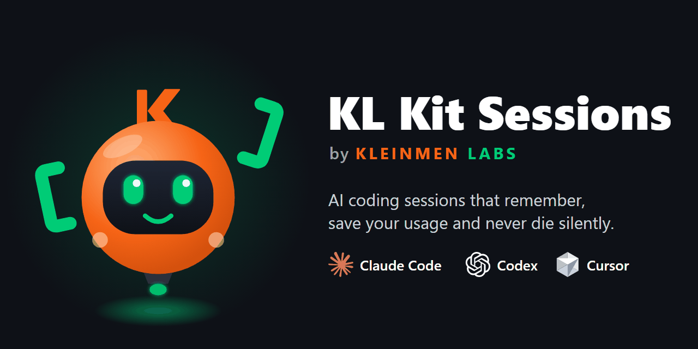

# KL Kit Sessions

*[Leer en español](README.es.md)*

AI coding sessions forget, burn through your usage limit and get cut off without warning. This kit fixes that with three plain files and five small hooks. No servers, no extra models, no dependencies beyond Python.

**Works with:** Claude Code, Codex, Cursor and any agent that reads `AGENTS.md` (the rules and files). The hooks are for **Claude Code only**.

## What's new
- **v1.3 (Nov 18, 2026):** an optional **status bar** for Claude Code: *"KL Kit Sessions: 426k tokens saved with /clear · this window: 105k · 5 windows: 380k"*. It counts what the kit saved you (each heavy conversation you cleared or that the guard blocked counts once, with its size), how heavy this window is right now and the total of your open windows. New `tokens_saved.py` hook, used by `heavy_session.py` and `remember_window.py`. 31 tests.
- **v1.2 (Nov 17, 2026):** the ready-to-paste prompt **can no longer approve things for you.** It only carries tasks you asked for, never "the user said yes" when you did not. If the last answer left you a question and you did not answer it, after `/clear` the new session asks it again first and waits, instead of doing the task. If the prompt mentions an approval, the session checks that you really said it. 27 tests.
- **v1.1 (Nov 16, 2026):** after `/clear`, each window goes back to **its own** task instead of grabbing another window's work. "Continue" now means the prompt that window left you (or your last request), it finds the real project even if the session was opened in another folder, and a new hook, `message_to_window.py`, makes sure a request reaches the right window and only one. 23 tests.
- **v1.0 (Nov 16, 2026):** first release.

## The problem
- **Every new session starts from zero.** You explain the project again, or the agent reads half the repo to find out where things stand.
- **Long sessions get expensive.** Coming back to a huge conversation after an hour reloads all of it at once and can eat a big part of your 5-hour limit in a single message.
- **The cut-off comes without warning.** The agent cannot see how many tokens it has used, so the session dies mid-task and whatever was only in the chat is lost.

## The fix
| Piece | What it does |
|---|---|
| `STATE.md` | One page: Now · Done · Next · Key facts. The **only** thing a new session reads. It gets replaced, never turned into a diary. |
| `STATE_tracks.md` | For several sessions at once in the same folder: one section per track. Also for the parts of one project, and for a parent folder with several projects inside (one track per project). "How are we doing?" gives one line per track, most recent first; "continue" carries on with the most recent track and says which. |
| `HISTORY.md` | One line per finished thing. Never read at start; only searched when an old fact is needed. |
| `AGENTS.md` rules (+ `CLAUDE.md` that loads them) | Read STATE.md on start, write it down **after every step** (not only at the end), and hand over a ready-to-paste prompt when the session gets heavy. One file, read by every agent. |
| `heavy_session.py` hook (Claude Code) | Heavy and idle session: blocks your message before it is sent (costs nothing). Heavy and active: tells Claude its exact size once, so it saves and gives you the prompt for a fresh session. |
| `continue_after_clear.py` hook (Claude Code) | After `/clear`, type "continue" (or the track name) instead of pasting the prompt. "Continue" means the task **that window** was doing: the prompt its last answer left you, or your last request. It finds the project the window really worked on, even if it was opened in another folder, and keeps its hands off what other windows are doing. |
| `remember_window.py` hook (Claude Code) | Runs at `/clear` and notes which conversation this window had, so `continue_after_clear.py` knows the track it was on, even if another window updated STATE.md later. |
| `message_to_window.py` hook (Claude Code) | Before a session sends a message to another window named after its folder (`app-77`, `app-62`…), it shows what every open window is doing, so the request goes to the right one. The same request never goes to two windows. |
| `tokens_saved.py` (Claude Code) | Counts the tokens the kit saved you: when `heavy_session.py` blocks a heavy idle conversation or you `/clear` one, its size is added once to `~/.claude/hooks/tokens_saved.json`. An estimate. |
| Status bar `plugin/` (Claude Code, optional) | Always on screen: tokens saved with `/clear`, this window's size and the total of your open windows. Refreshes every minute and after each reply. |
| `require_state.py` hook (Claude Code) | If Claude changed files in a project with a STATE.md and did not update it, it cannot finish its turn until it does. |

A new session then starts with: *"Continue with the project. Read only the rules file and STATE.md. First in 'Next' is: …"*, and it is cheap and up to speed in a minute.

## Install
1. **Per project** (any agent): copy `templates/` into the project and fill in `AGENTS.md` and `STATE.md`. `CLAUDE.md` only contains `@AGENTS.md`, so Claude Code reads the same rules. A project's own rules always win over the global ones.
2. **Global rules** (optional, every project) from `global/AGENTS.md`. If you already have global rules, append instead of replacing:
   - Claude Code: copy it to `~/.claude/CLAUDE.md`.
   - Codex: copy it to `~/.codex/AGENTS.md`.
   - Cursor: paste it into Settings → Rules → User Rules.

### Claude Code extras
3. **Hooks:** copy the `hooks/*.py` files to `~/.claude/hooks/` and merge the `hooks` block from `hooks/settings.example.json` into `~/.claude/settings.json`. On Windows, use `python` instead of `python3` and a full path such as `C:/Users/you/.claude/hooks/heavy_session.py`.
4. **Skill (optional):** copy `skills/session-kit` to `~/.claude/skills/session-kit`. Then type `/session-kit` in any project to set it up for you.
5. **Status bar (optional):** run `claude plugin marketplace add kleinmenlabs/kl-kit-sessions` and then `claude plugin install kl-kit-sessions-bar@kl-kit-sessions` (or `/plugin` inside Claude Code). It shows on new sessions. It reads `~/.claude/hooks/` (or `$CLAUDE_CONFIG_DIR/hooks/`), so install the hooks of step 3 first.

Check the hooks with `python3 tests/test_hooks.py` (31 cases, no real sessions involved) and the bar with `claude plugin test plugin`.

## Settings
At the top of `hooks/heavy_session.py`:
- `HEAVY_TOKENS = 100_000`: context size that counts as heavy.
- `IDLE_MINUTES = 55`: how long before an idle heavy session gets blocked. Matches a 1-hour prompt cache; lower it if your cache expires sooner.
- `FORCE_WORD = "force"`: start a message with it to skip the block.

At the top of `hooks/require_state.py`: `MARGIN_MINUTES = 30` and the file name `STATE.md`.

## Contributing
Found a bug or have an idea? Open an issue with the forms, or read [CONTRIBUTING.md](CONTRIBUTING.md) before sending a pull request.

## Notes
- The hooks read only the session transcript that Claude Code already keeps on your machine. They send nothing anywhere.
- If a hook fails for any reason, it does nothing: it never blocks by mistake.
- The files are in English because models follow it well and it uses fewer tokens. The agent still answers you in your own language.
- The hooks read Claude Code's transcript format. Other agents keep their sessions differently, so the hooks do not apply there; the rules and files do.

## License
MIT. See [LICENSE](LICENSE).

---
Made by **Kleinmen Labs**.
